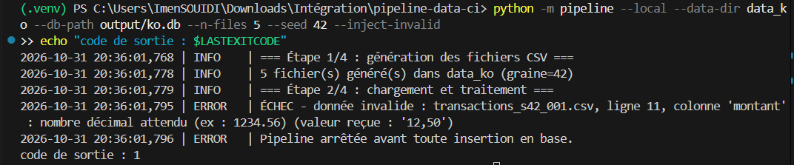
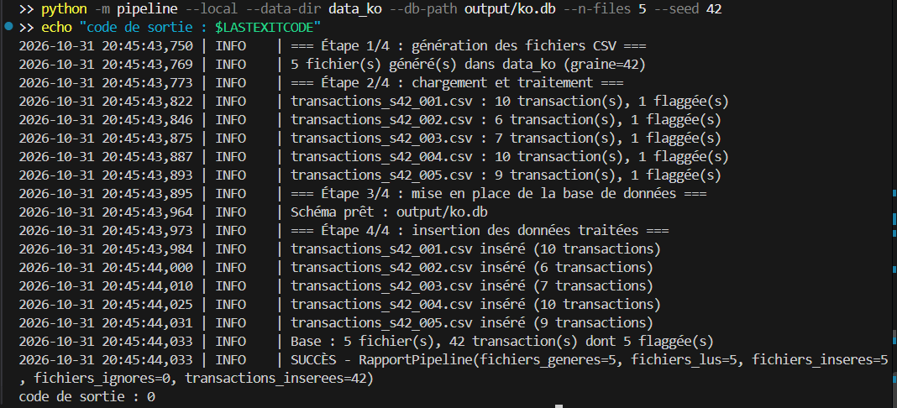
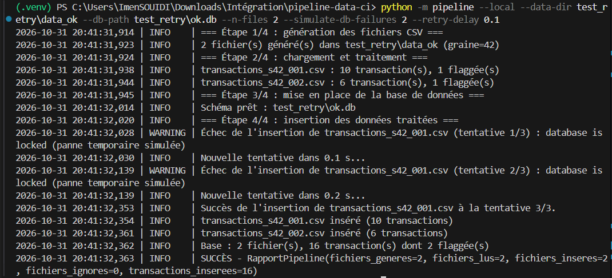
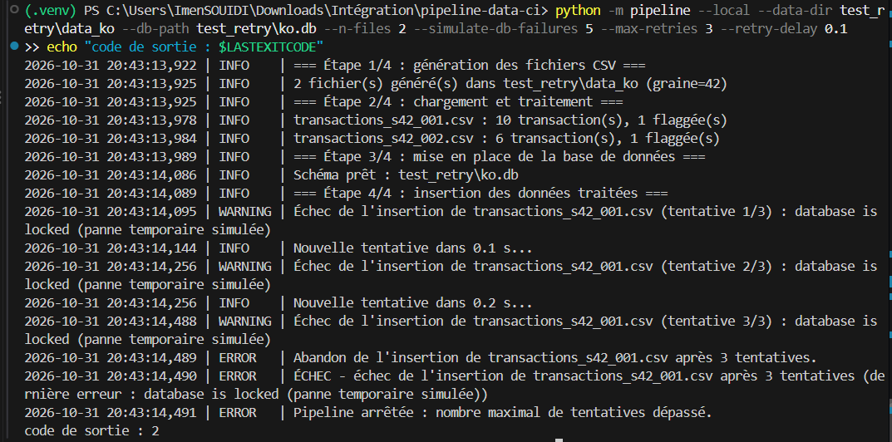
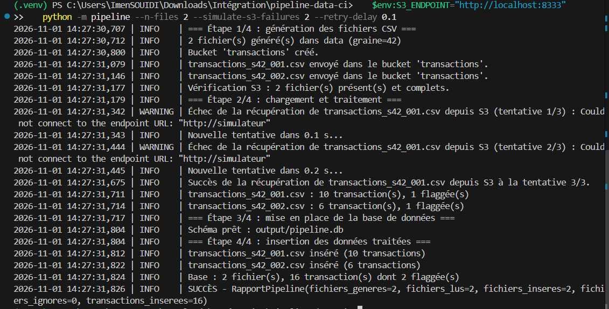

# Pipeline data CI

Pipeline de données : génération de transactions CSV, stockage dans un service S3 (SeaweedFS), traitement, insertion dans une base SQLite, avec tests d'intégration, retry et déploiement automatisé.

## Architecture

```
Génération CSV -> Upload S3 (bucket "transactions") -> Vérification
                                                         |
                                                         v
                            Téléchargement S3 (retry) -> Chargement -> Traitement -> Base SQLite
```

- `pipeline/generator.py` : génère les CSV (graine fixe, IBAN valides, cas limites).
- `pipeline/loader.py` : valide chaque ligne du CSV (aucun calcul).
- `pipeline/processing.py` : traitements purs (sommes, flag > 5000).
- `pipeline/s3.py` : envoi, vérification et récupération des fichiers S3.
- `pipeline/retry.py` : retry avec attente exponentielle et simulateur de pannes.
- `pipeline/database.py` + `schema.sql` : insertion atomique, anti-doublon par hash SHA-256.
- `infra/` : infrastructure Azure (Terraform).

## Installation

```bash
python -m venv .venv
source .venv/bin/activate        # Windows : .venv\Scripts\activate
pip install -r requirements-dev.txt
```

## Tests et qualité

```bash
ruff check .
python -m pytest
```

Les tests utilisent un faux S3 en mémoire (moto) : aucun service externe n'est nécessaire.

## Lancer la pipeline

Mode local (CSV lus depuis le dossier, sans S3) :

```bash
python -m pipeline --local --n-files 5 --seed 42
```

Mode S3 (nécessite un service S3, voir ci-dessous) :

```bash
python -m pipeline --n-files 5 --seed 42
```

Options utiles :

| Option | Rôle |
|---|---|
| `--inject-invalid` | injecte une donnée invalide (simulation d'échec) |
| `--simulate-db-failures N` | N pannes temporaires à l'insertion |
| `--simulate-s3-failures N` | N pannes temporaires au téléchargement S3 |
| `--max-retries N` | nombre maximal de tentatives |
| `--every S` | relance la pipeline toutes les S secondes |

## Service S3 local (Docker)

```bash
docker compose up --build
```

Lance SeaweedFS (port 8333) et la pipeline, qui tourne toutes les 5 minutes.

Le conteneur S3 est démarré en premier par Compose. Avant la première étape, la pipeline attend que le service S3 réponde (jusqu'à 60 s) et échoue proprement s'il reste injoignable.

## Déploiement sur Azure (Terraform)

Prérequis : Azure CLI, Terraform, un compte Docker Hub, et un abonnement Azure.

```bash
az login
cd infra
cp terraform.tfvars.example terraform.tfvars   # à remplir : subscription_id, pipeline_image
terraform init
terraform plan
terraform apply
```

Le fichier `terraform.tfvars` contient des secrets : il n'est jamais versionné.

Vérifier les logs :

```bash
az container logs --resource-group rg-pipeline-data --name ci-pipeline-data --container-name pipeline
```

Supprimer les ressources :

```bash
terraform destroy
```

## CI/CD

- `.github/workflows/ci.yml` : à chaque push et pull request, vérifie le code (ruff), exécute la pipeline en local, construit l'image Docker et lance les tests.
- `.github/workflows/cd.yml` : à chaque push sur `main`, publie l'image sur Docker Hub (job `publish`), puis déploie sur la VM en SSH (job `deploy`) : copie `docker-compose.vm.yml`, tire la nouvelle image et relance les conteneurs.

Secrets GitHub nécessaires :

| Secret | Rôle |
|---|---|
| `DOCKERHUB_USERNAME` | nom d'utilisateur Docker Hub |
| `DOCKERHUB_TOKEN` | token Docker Hub (lecture/écriture) |
| `VM_HOST` | adresse IP de la VM |
| `VM_USER` | utilisateur SSH de la VM |
| `VM_SSH_KEY` | clé SSH privée (la clé publique est ajoutée sur la VM) |

## Déploiement sur la VM (niveau 3, option 1)

L'environnement de production tourne sur une machine virtuelle, dans des conteneurs Docker :

- `s3` : SeaweedFS, le service S3 ;
- `pipeline` : la pipeline, qui relance le traitement toutes les 5 minutes (`--every 300`) et stocke sa base SQLite dans un volume Docker.

Le fichier `docker-compose.vm.yml` décrit cet environnement. Il utilise l'image publiée sur Docker Hub, sans build sur la VM.

Vérifier l'environnement déployé :

```bash
ssh -i <clé_privée> ubuntu@<ip_vm> "cd pipeline-data && docker compose ps && docker compose logs --tail 20 pipeline"
```

## Déploiement d'infrastructure (niveau 3, option 4)

Le dossier `infra/` décrit avec Terraform les ressources Azure (groupe de ressources et groupe de conteneurs). Il est appliqué à la main avec `terraform apply`, car le compte étudiant ne permet pas de créer l'identité nécessaire à GitHub pour un déploiement automatique vers Azure.

## Démonstration (étapes 6 et 7)

Les captures sont dans le dossier `docs/`. Commandes en mode local (`--local`), dans un environnement où `.venv` est activé.

### Étape 6 : échec de la pipeline et correction

**Cause** : le fichier `transactions_s42_001.csv` contient un montant écrit avec une virgule (`12,50`) au lieu d'un point (`12.50`). Le format attendu est un nombre décimal.

**Échec** (`docs/capture1.png`) :

```bash
python -m pipeline --local --data-dir data_ko --db-path output/ko.db --n-files 5 --seed 42 --inject-invalid
```



La pipeline s'arrête avant toute insertion en base, avec le message :

```
ÉCHEC - donnée invalide : transactions_s42_001.csv, ligne 11, colonne 'montant' : nombre décimal attendu (ex : 1234.56) (valeur reçue : '12,50')
```

Le code de sortie est `1`.

**Correction** : régénérer les fichiers avec un montant au bon format (le point remplace la virgule). Sans `--inject-invalid`, la génération écrit des montants valides.

**Réussite après correction** (`docs/capture2.png`) :

```bash
python -m pipeline --local --data-dir data_ko --db-path output/ko.db --n-files 5 --seed 42
```



Les 5 fichiers sont traités et insérés (`fichiers_inseres=5`, 42 transactions), code de sortie `0`.

### Étape 7 : retry lors de l'insertion

Le retry réessaie l'insertion en cas d'erreur temporaire (`database is locked`), avec un délai qui double à chaque tentative (0,1 s, puis 0,2 s). La panne est simulée avec `--simulate-db-failures`, et le nombre de tentatives est fixé par `--max-retries`.

**Retry qui réussit** (`docs/capture3.png`) : deux pannes, succès à la 3e tentative.

```bash
python -m pipeline --local --data-dir test_retry/data_ok --db-path test_retry/ok.db --n-files 2 --simulate-db-failures 2 --retry-delay 0.1
```



**Retry qui abandonne** (`docs/capture4.png`) : cinq pannes pour trois tentatives. La pipeline s'arrête proprement avec le code `2`.

```bash
python -m pipeline --local --data-dir test_retry/data_ko --db-path test_retry/ko.db --n-files 2 --simulate-db-failures 5 --max-retries 3 --retry-delay 0.1
```



### Niveau 2 : retry lors de la récupération depuis S3

Les fichiers sont envoyés dans le bucket S3, puis téléchargés avec retry. Deux pannes sont simulées (`--simulate-s3-failures 2`) : la pipeline réessaie avec un délai et réussit à la 3e tentative. Le service S3 doit tourner (`docker compose up -d s3`).

```powershell
$env:S3_ENDPOINT="http://localhost:8333"
python -m pipeline --n-files 2 --simulate-s3-failures 2 --retry-delay 0.1
```



### Anti-doublon

Chaque fichier est identifié par son hash SHA-256 dans la table `processed_files`. L'insertion d'un fichier est atomique : en cas de panne, tout est annulé, donc un retry ne crée jamais de doublon.
